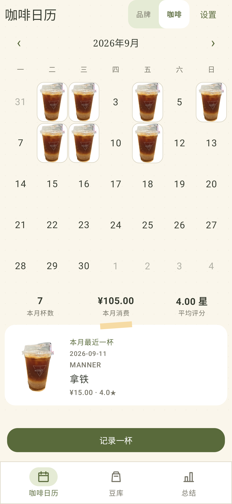
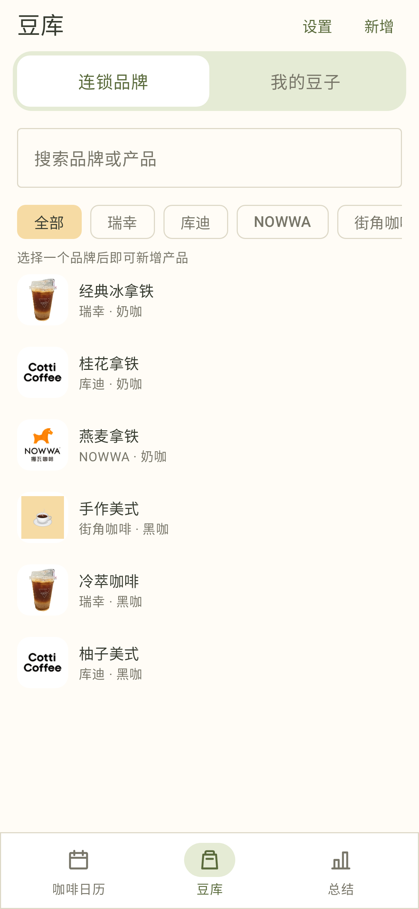
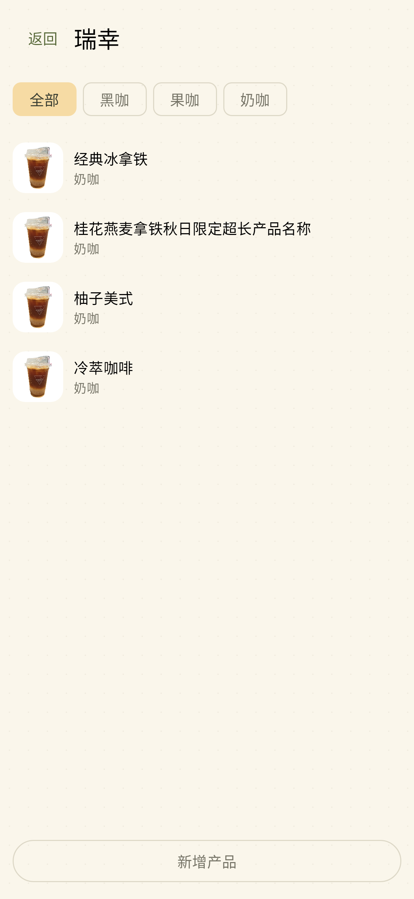
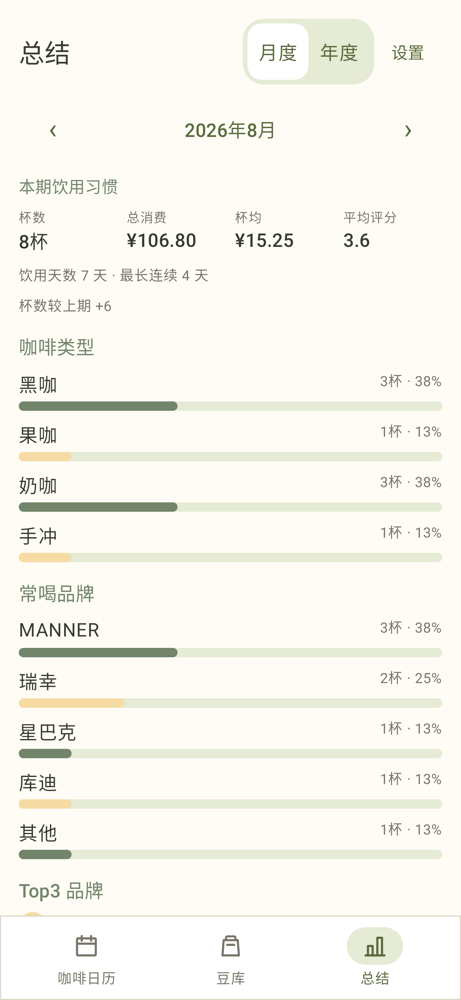

# 咖啡日历

“咖啡日历”是一款面向个人使用的 Android 本地咖啡记录 App：记录每天喝的连锁咖啡和个人豆子，用月历按品牌或咖啡图片回看，并提供月度／年度总结、手动豆库和 ZIP 备份恢复。App 本身不主动联网、不需要账号；记录和图片存放在 App 私有目录。你主动把导出的备份传到云盘、聊天工具或电脑时，则由你选择的传输服务负责保存。

## 产品真实预览

以下图片由当前 Android 客户端的真实 Jetpack Compose 页面渲染生成，使用演示记录与实拍照片素材，日历保留奶油纸底与照片便签，豆库和总结采用浅暖画布、小缩略图与柔和绿色。

| 咖啡日历 | 豆库 |
| --- | --- |
|  |  |
| 品牌产品列表 | 月度总结 |
|  |  |

点击图片可查看原始尺寸。预览使用测试数据，照片素材不会随 App 安装包发布。

## 手机下载安装与首次试用

### 准备 APK

当前版本为 **1.1.1**（Android versionCode `3`），支持 **Android 6.0（API 23）及以上**。保持原包名与原 debug 签名，版本号高于此前的 1.0 和 1.1，可覆盖升级并保留本地数据；安装器显示“更新”或“重新安装”等措辞由手机系统决定。Debug APK 的构建输出路径为：

```text
app/build/outputs/apk/debug/app-debug.apk
```

若从 GitHub 下载，请下载同名的 `app-debug.apk` 文件；不要把整个源码 ZIP 当作安装包。

### 从电脑传到手机并安装

1. 用 USB 数据线把 APK 复制到手机的“下载”或任意容易找到的文件夹；也可以通过聊天工具“以文件发送”、网盘或 AirDrop 类工具传输。它们只用于传递 APK／备份文件，App 安装后仍完全离线。
2. 在手机的“文件管理”“下载”或收到文件的聊天工具中，点开 `app-debug.apk`。
3. 首次侧载时，Android 会提示“允许此来源安装未知应用”或“允许来自此来源的应用”。按提示仅为当前的文件管理器、浏览器或聊天工具开启一次即可。不同手机厂商的设置名称与路径会略有不同。
4. 若 Google Play Protect 显示“未知应用”提示，请确认 APK 来自你信任的构建或仓库后，选择继续安装；不要安装来源不明的 APK。
5. 安装完成后，在桌面打开“咖啡日历”。首次进入即可直接使用，无需登录或网络。

### 用 USB 调试安装（可选）

如果电脑已安装 Android Platform Tools，手机开启“开发者选项”与“USB 调试”、连接后已点“允许”，可在项目根目录执行：

```bash
adb install -r app/build/outputs/apk/debug/app-debug.apk
```

`-r` 会在新旧 APK **签名相同**时覆盖安装并保留数据。若提示签名不一致，不能直接覆盖：先在旧 App 的“设置”导出备份，再卸载旧 App、安装新包并恢复备份。

### Debug APK 能否长期自用？

可以。该 Debug APK 使用固定的 debug 签名，个人手机上可以长期保留和升级，只要后续仍使用同一签名并用 `adb install -r` 或正常覆盖安装，数据会保留。它同时是可调试包，不适合公开分发或作为正式商店发布包；Release 产物目前未配置个人签名，不能替代上述自用升级流程。

**在卸载 App、系统“清除数据”、更换手机，或准备安装不同签名的 APK 前，请先导出备份。**未导出的本地记录、图片和草稿将无法恢复。

## 日常使用

底部有三个 Tab：**咖啡日历**、**豆库**、**总结**。每个页面各自显示标题和设置入口，没有会遮挡内容的全局顶栏。

### 咖啡日历：记录、补记与月历图片

1. 在“咖啡日历”按月份浏览；用顶部的 **品牌／咖啡** 双选切换显示方式。
   - **品牌**：当天优先显示品牌 Logo。
   - **咖啡**：当天优先显示产品实拍图。
2. 同一天多杯咖啡会显示数量。没有产品图时，图片会按“产品实拍图 → 品牌 Logo → 通用占位图”回退。
3. 点新增记录，选择已有的连锁产品或个人豆子，填写饮用日期、价格、评分、冲煮方式和备注。记录是 date-only（本地中午保存），可改为过去任一天补记；不提供旧式时间输入。
4. 点有记录的日期，可逐条查看实拍图、评分和价格；支持为单条记录添加或更换图片，也可编辑或删除，删除前会再次确认。新增记录未完成的表单会保存为本机草稿，离开页面或重启后仍可继续填写。修改历史记录时，点击返回或系统返回会放弃本次未保存的编辑，历史记录保持不变；再次“记录一杯”进入新增流程。
5. 若当天喝到的新产品还不在豆库，可在记录流程中快捷新增；保存后新产品会自动选中，已经填写的记录草稿不会丢失。

导入的品牌 Logo、产品实拍图和个人豆子包装图都保留原始文件，不要求预先裁剪；界面以 Fit 显示，历史记录会保存当时的品牌、产品和图片快照，后来编辑或删除豆库项目不会改写过去的日历。当天详情中的“添加图片／更换图片”只修改选中记录的图片，同步显示在日历与总结中，不修改豆库或其他历史记录。内置品牌优先使用随 App 打包的 Logo，因此不依赖外部图片文件。

### 豆库：连锁品牌、产品与个人豆子

“连锁品牌”首页以小缩略图列表展示产品，可按产品名或品牌名搜索，并用横向品牌标签筛选。保留 12 个预置品牌；选中品牌后可进入品牌管理页。

- **添加品牌**：在连锁品牌页选择新增，填写品牌名称并从系统文件选择器选一张 Logo。自定义品牌可在之后编辑名称或 Logo。
- **添加产品**：在新增菜单选择产品并指定品牌，或进入品牌管理页新增产品，填写名称，选择“黑咖／果咖／奶咖”，并可选一张整张实拍图。没有产品图时会显示品牌 Logo。
- **编辑与删除**：可编辑自定义品牌及所有手动产品的名称、图片和分类。内置的 12 个品牌不能删除；自定义品牌必须先删除其全部产品后才能删除。删除前会要求确认。
- **个人豆子**：处理法可从常见选项选择或自行输入，烘焙度提供常见选项；购买日期和烘焙日期用日历选择，显示为 `2026-09-18`，也可清除。不再设置默认冲煮方式，饮用记录仍可单独填写。
- **豆子状态**：支持“正在喝”“已喝完”“养豆中”。养豆中需填写不晚于今天的烘焙日期，“正在喝”和“养豆中”的列表均显示烘焙距今天数（烘焙当天为 `0天`），缺少或无效的烘焙日期会提示补充。已喝完按该豆子的全部有效历史评分均值从高到低排列，无评分的豆子排在最后；同分按名称与 ID 稳定排序。升级和恢复旧备份时，旧归档豆子并入已喝完，记录和图片保留。

目录完全手动维护：没有官网产品更新、截图识别、OCR 或自动裁剪功能。

### 总结：按月或按年回顾

在“总结”选择月度或年度视图，可查看饮用天数、连续天数、消费与评分、与上期的杯数比较、咖啡类型与品牌占比横条、Top 3 偏好，以及最好／最差的历史记录卡。未填写价格或评分的记录仍会计入杯数，但不会被虚构为金额或评分；个人豆会归入“手冲”。

### 设置、备份与恢复

在任一根页面进入“设置”：

1. **导出备份**：通过系统文件选择器保存 ZIP。建议保存在可信位置，并可自行复制到电脑或云盘。
2. **恢复备份**：选择以前导出的 ZIP。恢复会替换当前全部数据，因此请先导出当前数据。当前备份包含 v5 数据库，仍兼容数据库版本 v1–v4 的旧备份；恢复时会补全旧记录的咖啡类型，并转换个人豆子的旧归档状态。包含新状态的 v5 备份需使用新版 App 恢复。
3. 备份未加密，可能包含备注和图片；不要上传到不可信位置。

## 离线、权限与隐私

App 不主动联网：没有官网更新、OCR、截图裁剪、ML Kit、OkHttp 或 `INTERNET` 权限，也没有相机、定位或宽泛存储权限。选择图片以及导出／恢复备份时，使用 Android 系统文件选择器，只访问你明确选择的单个文件。

没有账号、广告、云同步、自建服务器或行为分析。记录、草稿、目录、图片和备份处理均在本机完成；只有你手动导出的文件可能会被你选用的外部传输或存储服务保存。

## 构建

前置环境：JDK 17、Android SDK Platform 36、Build Tools 36.0.0；若需 USB 安装，还需 Android SDK Platform Tools。

在项目根目录执行完整发布矩阵：

```bash
./.local-tools/gradle-8.13/bin/gradle clean testDebugUnitTest lintDebug assembleDebug assembleDebugAndroidTest assembleRelease --no-daemon
```

如环境尚未配置，使用项目本地工具：

```bash
export JAVA_HOME="$PWD/.local-tools/jdk/Contents/Home"
export ANDROID_HOME="$PWD/.local-tools/android-sdk"
export GRADLE_USER_HOME="$PWD/.gradle"
export PATH="$JAVA_HOME/bin:$ANDROID_HOME/platform-tools:$PATH"
```

连接设备后的 instrumentation 验证：

```bash
./.local-tools/gradle-8.13/bin/gradle connectedDebugAndroidTest --no-daemon
```

使用内置的真实产品照片 fixture 生成品牌／咖啡日历评审图：

```bash
./.local-tools/gradle-8.13/bin/gradle --offline --no-daemon -PcalendarPreview --rerun-tasks \
  testDebugUnitTest --tests com.niumi.coffeejournal.CalendarPreviewRenderTest
```

照片来自 `app/src/test/resources/fixtures/IMG_20260815_193103.png`，不会依赖运行机器绝对路径。输出为：

- `app/build/reports/previews/calendar-brand-cream-forest.png`
- `app/build/reports/previews/calendar-coffee-cream-forest.png`
